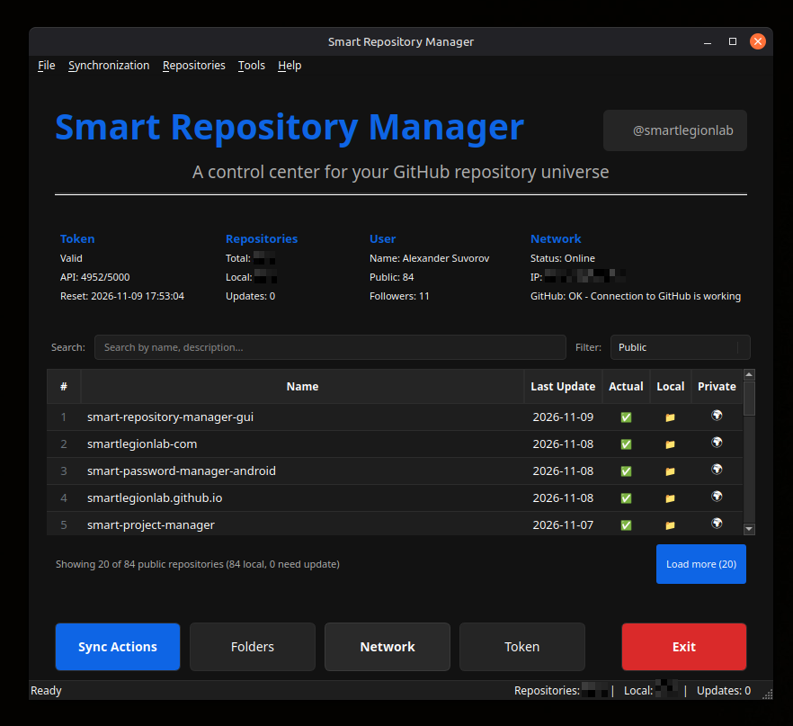

# Smart Repository Manager GUI

---

A powerful desktop application for managing GitHub repositories with intelligent synchronization, and comprehensive visual management tools.

---

[](https://github.com/smartlegionlab/smart-repository-manager-gui/)

[](https://github.com/smartlegionlab/smart-repository-manager-gui/blob/master/LICENSE)
[](https://github.com/smartlegionlab/smart-repository-manager-gui/stargazers)
[](https://github.com/smartlegionlab/smart-repository-manager-gui/network/members)

---

## Screenshot



---

## Overview

**Smart Repository Manager GUI** provides a complete visual interface for managing your GitHub repositories.

**Key Benefits:**
- **Visual Management**: Full graphical interface for all operations
- **Smart Table**: Lazy-loading repository list with filtering and search
- **Multi-User Support**: Switching between GitHub accounts
- **Keyboard-Driven**: Complete keyboard shortcuts for power users

---

## System Initialization

Every session begins with a **mandatory system checkup**:

1. **Directory Structure** - Creates and verifies workspace organization
2. **Internet Connection** - Validates network connectivity
3. **User Management** - Select or add GitHub account
4. **User Data** - Fetches GitHub profile information
5. **Repository Loading** - Retrieves complete repository list
6. **Local Copy Check** - Scans for existing local repositories
7. **Update Detection** - Identifies repositories needing updates

---

## Synchronization Operations

### **1. Synchronize All** `(Ctrl+S)`
Complete bidirectional sync - clones missing repositories and updates existing ones.

### **2. Update Needed Only** `(Ctrl+U)`
Smart update detection - only pulls repositories with new commits.

### **3. Clone Missing Only** `(Ctrl+M)`
Selective cloning - cloning only repositories not present locally.

### **4. Sync with Repair** `(Ctrl+Shift+R)`
Advanced recovery - detects and fixes corrupted repositories, then syncs.

### **5. Re-clone All**
Complete refresh - removes and re-clones all local repositories.

### **6. Download All As Zip**
Complete parallel download - download all repositories as ZIP archives.

**Live Console**: Every sync operation displays real-time logs with timestamp, status, and duration for each repository.

---

## Main Dashboard

### Repository Table
- **Lazy Loading**: Loads 20 repositories at a time for optimal performance
- **Smart Filtering**: Filter by Local/Remote, Needs Update, Private/Public, Forks, Archived
- **Instant Search**: Real-time filtering by name, description, or language
- **Visual Indicators**: Status icons for local presence and update requirements
- **Context Menu**: Right-click actions for quick operations

### Status Panels

| Panel            | Information Displayed                                    |
|------------------|----------------------------------------------------------|
| **Token**        | Token validity, API limits (remaining/total), reset time |
| **Repositories** | Total count, local copies, pending updates               |
| **User**         | Display name, public repos, followers count              |
| **Network**      | Connection status, external IP, GitHub accessibility     |

### Detail Dialogs
- **User Information** - Complete GitHub profile with avatar
- **Token Information** - Token scopes, creation date, rate limits
- **Network Information** - DNS, server responses, connection quality
- **Storage Management** - Disk usage, cleanup tools, repository details

---

## Keyboard Shortcuts

### File
| Shortcut | Action         |
|----------|----------------|
| `Ctrl+B` | Create Archive |
| `F5`     | Refresh        |
| `Ctrl+Q` | Exit           |

### Synchronization
| Shortcut       | Action                    |
|----------------|---------------------------|
| `Ctrl+S`       | Synchronize All           |
| `Ctrl+U`       | Update Needed Only        |
| `Ctrl+M`       | Clone Missing Only        |
| `Ctrl+Shift+R` | Sync with Repair          |
| `Ctrl+Alt+R`   | Re-clone All Repositories |
| `Ctrl+Shift+S` | Sync Selected             |
| `Ctrl+Shift+C` | Clone Selected            |
| `Ctrl+Shift+U` | Update Selected           |
| `Ctrl+Shift+D` | Download all repositories |

### Repositories
| Shortcut       | Action            |
|----------------|-------------------|
| `Ctrl+Shift+B` | Open in Browser   |
| `Ctrl+L`       | Open Local Folder |
| `Ctrl+D`       | Show Details      |
| `Ctrl+R`       | Refresh List      |
| `Ctrl+Del`     | Delete Local Copy |

### Tools
| Shortcut       | Action              |
|----------------|---------------------|
| `Ctrl+I`       | User Information    |
| `Ctrl+T`       | Token Information   |
| `Ctrl+Shift+N` | Network Information |
| `Ctrl+Shift+M` | Storage Management  |

### Help
| Shortcut       | Action             |
|----------------|--------------------|
| `F1`           | Documentation      |
| `Ctrl+/`       | Keyboard shortcuts |
| `Ctrl+Shift+A` | About              |

---

## Multi-User Management

- **Add Users**: Quick token validation and GitHub profile fetch
- **Switch Users**: Instant context switching with visual feedback
- **Delete Users**: Complete removal of user data and tokens
- **Avatar Support**: Automatic avatar download and circular display
- **Persistent Storage**: Token storage per user

---

## Requirements

- Python 3.8 or higher
- Git installed and configured
- `curl` (only for the installer)
- GitHub Personal Access Token (with `repo` scope)
- PyQt5

### Generate GitHub Token

1. Visit [GitHub Tokens](https://github.com/settings/tokens/new)
2. Select permissions:
   - `repo` (full repository access)
3. Generate and copy token

---

## Installation

There are **two independent ways** to use this application:

- **Run from source** - clone the repo, create a virtual environment, launch manually. Nothing is installed system-wide.
- **Install system-wide** - one command creates a menu entry. Desktop shortcut is opt-in.

Choose one. They are not meant to be combined.

### Option 1 — Run from Source (no system install)

Use this if you just want to try the app or run it manually from a folder.

```bash
# 1. Clone the repository
git clone https://github.com/smartlegionlab/smart-repository-manager-gui.git
cd smart-repository-manager-gui

# 2. Create a virtual environment
python3 -m venv venv

# 3. Activate it
source venv/bin/activate

# 4. Install dependencies
pip install -r requirements.txt

# 5. On Linux you may need this system library for Qt
sudo apt install libxcb-cursor0

# 6. Launch the app
python app.py
```

To run it again later:

```bash
cd smart-repository-manager-gui
source venv/bin/activate
python app.py
```

Nothing is installed system-wide. The app runs from this folder.

### Option 2 — Install System-Wide (recommended)

Use this if you want the app in your application menu.

#### One-command install

```bash
curl -fsSL https://raw.githubusercontent.com/smartlegionlab/smart-repository-manager-gui/master/install.sh | bash
```

**What the installer does:**

1. Downloads the source code from GitHub.
2. Installs the application to `~/.local/share/smart-repository-manager-gui/`.
   No root, no sudo - everything lives inside your home directory.
3. Creates a dedicated Python virtual environment at `~/.local/share/smart-repository-manager-gui/venv/` and installs dependencies into it.
4. Registers the app in your desktop environment by creating `~/.local/share/applications/smart-repository-manager-gui.desktop`.
5. Refreshes the desktop database so the menu entry appears without a full re-login on most systems.

**Launch after install:**
- Application menu -> **Smart Repository Manager**

**Desktop shortcut (opt-in):**

By default, no Desktop shortcut is created. This is intentional - on GNOME (default on Ubuntu), desktop icons are hidden by default, which would make a shortcut invisible and confusing.

To also create a Desktop shortcut during install, pass the `SRM_CREATE_DESKTOP_SHORTCUT=1` environment variable to **bash** - the second command in the pipeline:

```bash
curl -fsSL https://raw.githubusercontent.com/smartlegionlab/smart-repository-manager-gui/master/install.sh | SRM_CREATE_DESKTOP_SHORTCUT=1 bash
```

Or export it first, then run the normal installer:

```bash
export SRM_CREATE_DESKTOP_SHORTCUT=1
curl -fsSL https://raw.githubusercontent.com/smartlegionlab/smart-repository-manager-gui/master/install.sh | bash
```

> **Note:** Writing `SRM_CREATE_DESKTOP_SHORTCUT=1 curl ... | bash` does **not** work - in a shell pipeline, an environment variable prefix applies only to the command on the **left** side of the `|`. The variable never reaches `bash`, which is on the right side. Pass it to `bash` directly, or `export` it beforehand.

**Notes:**
- On GNOME (default on Ubuntu), desktop icons may be hidden by default. Enable Desktop Icons in GNOME Tweaks to see the shortcut.
- The Desktop shortcut may show an **"Unsecured Application Launcher"** warning. Right-click -> **Allow Launching** (one-time action).
- If the menu entry does not appear immediately, log out and back in.

#### Alternative — install from a cloned repo

If you already cloned the repository, you can run the installer locally:

```bash
cd smart-repository-manager-gui
./install.sh
```

It works the same way. It ignores any local `venv/` and creates its own under `~/.local/share/smart-repository-manager-gui/venv/`.

### Uninstall

```bash
curl -fsSL https://raw.githubusercontent.com/smartlegionlab/smart-repository-manager-gui/master/uninstall.sh | bash
```

**What the uninstaller removes:**
- `~/.local/share/smart-repository-manager-gui/` - the application and its venv
- `~/.local/share/applications/smart-repository-manager-gui.desktop` - the menu entry
- `~/Desktop/smart-repository-manager-gui.desktop` - the Desktop shortcut (if present)

**What the uninstaller never touches:**
- `~/smart_repository_manager/` - your repositories, archives, downloads, logs, backups, temp files, tokens and configuration. It is your data. Only you decide what to do with it.

If you want to remove your data as well, run after uninstall:

```bash
rm -rf ~/smart_repository_manager
```

### Installation Paths

| Item                       | Path                                                                 |
|----------------------------|----------------------------------------------------------------------|
| Application files          | `~/.local/share/smart-repository-manager-gui/`                       |
| Virtual environment        | `~/.local/share/smart-repository-manager-gui/venv/`                  |
| Application menu entry     | `~/.local/share/applications/smart-repository-manager-gui.desktop`   |
| Desktop shortcut (opt-in)  | `~/Desktop/smart-repository-manager-gui.desktop`                     |
| User data (repositories)   | `~/smart_repository_manager/`                                        |

---

## Directory Structure

```
~/smart_repository_manager/
├── config.json              # Multi-user configuration
├── username_1/              # User-specific directories
│   ├── repositories/        # Local Git repositories
│   ├── archives/            # ZIP backups
│   ├── downloads/           # Downloaded repositories as ZIP archives
│   ├── logs/                # Operation logs
│   ├── backups/             # Manual backups
│   ├── temp/                # Temporary files
│   └── avatar.png           # GitHub profile picture
└── username_2/              # Additional users
```

---

## Desktop Integration (Linux)

> **Note:** If you installed the app via `install.sh`, the application menu entry is already created automatically. The in-app option described below is useful when you run the app manually from a custom location, or when you want to add a Desktop shortcut on demand. It is also the recommended way for development: it creates a shortcut pointing to the **currently running instance** (your working copy), not to a copy under `~/.local/share/`.

**Creating Application Shortcuts:**

The application allows you to create desktop entries directly from the menu:

1. **Go to File -> Create Desktop Entry**
2. **Choose locations:**
   - Application Menu (`~/.local/share/applications/`) - adds to system app menu
   - Desktop (`~/Desktop/`) - creates shortcut on desktop
3. **Click "Create Entry"**

**What happens:**
- Creates `.desktop` file(s) with proper configuration
- Sets executable permissions automatically
- Uses application icon if available

**After creation:**
- **Application Menu**: log out and back in (or restart desktop) for the entry to appear
- **Desktop shortcut**: may show "Unsecured Application Launcher" warning
  - Right-click on shortcut -> "Allow Launching" or "Trust"
  - This is a one-time security confirmation

**Note:** This feature is only available on Linux systems with desktop environments that support `.desktop` files (GNOME, KDE, XFCE, etc.).

---

## Security

- **Local-Only**: All operations performed locally with GitHub API
- **No Telemetry**: No data is sent to external servers
- **No Account Linking**: Your GitHub account is not linked to any external service

---

## Related Projects

This GUI application is powered by the same core engine as:

### [Smart Repository Manager Core](https://github.com/smartlegionlab/smart-repository-manager-core)
A Python library for managing Git repositories with intelligent synchronization, SSH configuration validation, and GitHub integration. This library serves as the foundation for both CLI and GUI implementations.

### [Smart Repository Manager CLI](https://github.com/smartlegionlab/smart-repository-manager-cli)
A comprehensive command-line tool for users who prefer terminal-based workflows. Offers identical functionality in a text-based interface.

---

## Development Status

**ACTIVE DEVELOPMENT** - This project is under continuous development. While we strive for stability, you may encounter:

- Interface changes between versions
- New features in active testing
- Performance optimizations in progress
- Documentation updates pending

**Recommended for**: Development environments, personal use, testing
**Not recommended for**: Critical production systems without thorough testing

---

## Support & Contributions

### Issues
- **Bug Reports**: Please include system information, steps to reproduce, and error logs
- **Feature Requests**: Describe the use case and expected behavior
- **Questions**: Check existing issues before creating new ones

### Contributions
1. Fork the repository
2. Create a feature branch
3. Follow existing code style
4. Submit pull request with clear description

---

## License

BSD 3-Clause License - See [LICENSE](LICENSE) file for details.

Copyright © 2026, Alexander Suvorov. All rights reserved.

---

## Developer

**Alexander Suvorov**
- GitHub: [@smartlegionlab](https://github.com/smartlegionlab)
- Email: [smartlegionlab@gmail.com](mailto:smartlegionlab@gmail.com)

---

*Smart Repository Manager GUI - Visual control for your GitHub universe.*

---

## Disclaimer

**By using this software, you agree to the full disclaimer terms.**

**Summary:** Software provided "AS IS" without warranty. You assume all risks.

**Full legal disclaimer:** See [DISCLAIMER.md](https://github.com/smartlegionlab/smart-repository-manager-gui/blob/master/DISCLAIMER.md)

